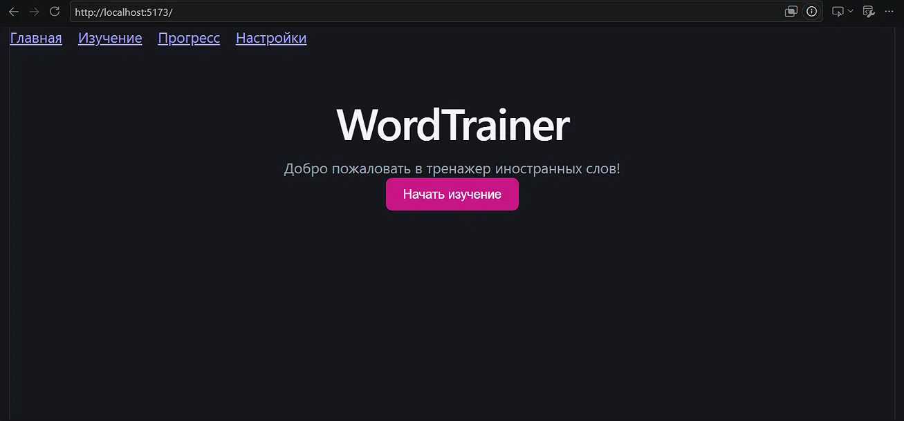
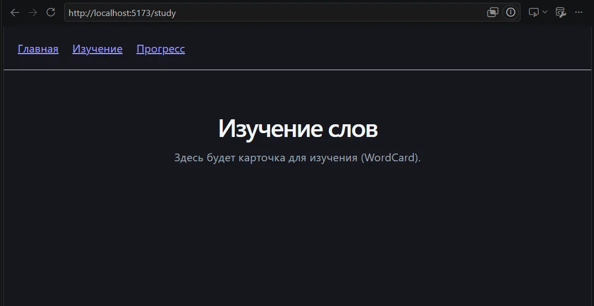
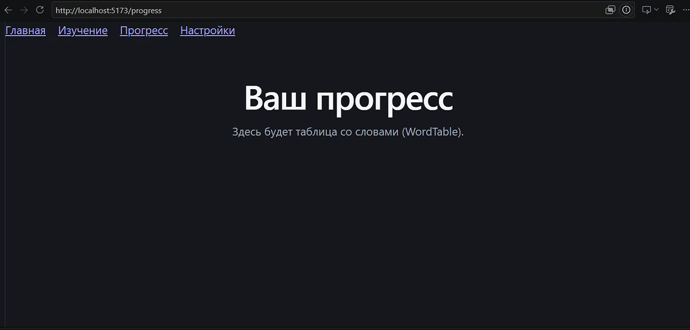

# WordTrainer Coursework

Курсовой проект — тренажер изучения иностранных слов с карточками и отслеживанием прогресса.

## Описание проекта
Проект представляет собой SPA-приложение для изучения иностранных слов. 
Архитектура проекта разделена на два независимых пакета (monorepo):
- app — основное React-приложение (Vite + TypeScript), содержащее роутинг, страницы и бизнес-логику.
- ui-library — библиотека общих переиспользуемых UI-компонентов (React + TypeScript), которая используется в основном приложении.

## Технологии
- React 19
- TypeScript
- Vite
- React Router DOM
- Jest + React Testing Library (для тестов)
- ESLint (для проверки кода)

## Инструкция по запуску

1. Установите зависимости и соберите библиотеку компонентов:
cd ui-library
npm install
npm run build

2. Установите зависимости для основного приложения:
cd ../app
npm install

3. Запустите приложение в режиме разработки:
npm run dev
Приложение будет доступно по адресу http://localhost:5173

## Проверка кода и тестов
Для проверки линтера (в папках app и ui-library):
npm run lint

Для запуска тестов и проверки покрытия (в папке ui-library):
npm test
npm run test:coverage

## Скриншоты работы

### Главная страница

### Страница изучения

### Страница прогресса
